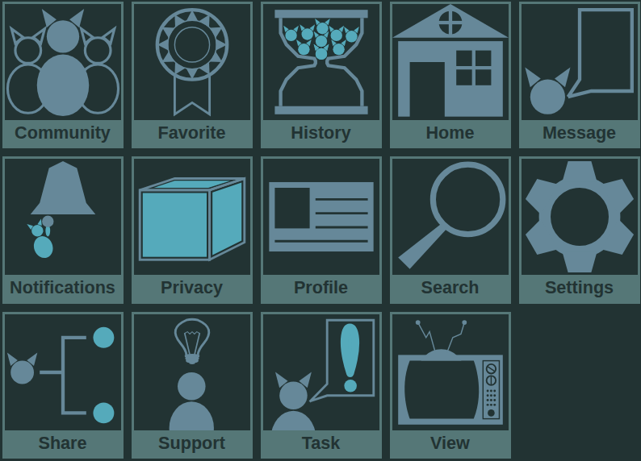

# cat-icons

A selection of cat-themed icons

## Preview

## Description

A set of 14 animated cat-themed icons.

Set includes next icons:
- Community
- Favorite
- History
- Home
- Message
- Notifications
- Privacy
- Profile
- Search
- Settings
- Share
- Support
- Task
- View

## Instructions

At this moment icon usage is only possible in inline form and WITH inclusion of css file coming with them.

To use icons:
- Past the code of icon into a preferred place in your project
- Add icons.css to the project by your preferred method

CSS file can be used to customize icon colors.

To change icon colors:
- Open icons.css file linked to your project
- Change variable --color-icon-primary and --color-icon-secondary values to your preference 

## License

This repository is licensed under the Creative Commons Attribution-NonCommercial 4.0 International License (CC BY-NC 4.0). See the "LICENSE" file for details.

@ 2026 VortexRiker

You are free to share and adapt this work for non-commercial purposes, provided appropriate attribution is given and any changes are indicated.
